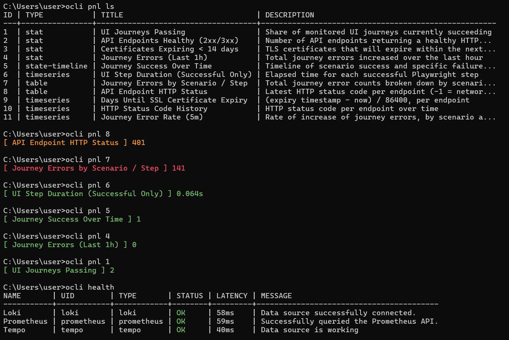

# OCLI: Observability command line interface

[](https://github.com/aizikfriedman/Observability-CLI/actions/workflows/ci.yml)
[](https://github.com/aizikfriedman/Observability-CLI/releases/latest)

Minimalist, terminal-first CLI in Go for querying Grafana dashboards, panels, alerts, DataSource health, and PromQL/LogQL engines (Prometheus, Thanos, VictoriaMetrics, Loki) with zero bloat and muscle-memory ergonomics.



---

## Installation

### Option 1: Download Pre-Built Binary (Recommended)

Download the pre-compiled binary for your operating system and architecture from the [**GitHub Releases**](https://github.com/aizikfriedman/Observability-CLI/releases/latest) page:

| OS | Architecture | Artifact Name |
| :--- | :--- | :--- |
| **Windows** | x64 (`amd64`) | `ocli-windows-amd64.exe` |
| **Windows** | ARM64 (`arm64`) | `ocli-windows-arm64.exe` |
| **Linux** | x86_64 (`amd64`) | `ocli-linux-amd64` |
| **Linux** | ARM64 (`arm64`) | `ocli-linux-arm64` |
| **macOS** | Apple Silicon (`arm64`) | `ocli-darwin-arm64` |
| **macOS** | Intel (`amd64`) | `ocli-darwin-amd64` |

#### Windows — One-Click Setup
1. Download `ocli-windows-amd64.exe` from the latest release.
2. **Double-click** the downloaded `.exe` file in Windows Explorer (or run `.\ocli-windows-amd64.exe install` in a terminal).
3. `ocli` installs itself into your user `PATH` (`%LOCALAPPDATA%\ocli\ocli.exe`), displays a confirmation message for 5 seconds, and closes:
   ```text
   Thank you for using OCLI!
   OCLI is now configured to run from anywhere.
   Type 'ocli setup' in your terminal from anywhere to get started.

   This window will close in 5 seconds...
   ```
4. Open any terminal (`PowerShell`, `CMD`, Windows Terminal) from anywhere and run `ocli setup`.

#### Linux & macOS
Make the downloaded binary executable and run `install` to copy `ocli` into `~/.local/bin/ocli` (if `~/.local/bin` is not in your `PATH`, `ocli` will ask `[Y/n]` before adding it to your shell profile):

```bash
# Linux (x86_64)
chmod +x ocli-linux-amd64
./ocli-linux-amd64 install

# macOS (Apple Silicon)
chmod +x ocli-darwin-arm64
./ocli-darwin-arm64 install
```

### Option 2: Install from Source (Go)

If you have Go installed, install directly into `$GOPATH/bin`:

```bash
go install github.com/aizikfriedman/Observability-CLI@latest
# or from a local clone:
go install .
```

---

## Configuration

Run interactive setup or configure via environment variables (`OCLI_URL`, `OCLI_TOKEN`):

```bash
ocli setup
```

Configuration is saved in `~/.ocli.yaml` (`0600` permissions), including DataSource aliases for single-flag routing and automatic dashboard context memory:

```yaml
url: https://grafana.example.com
token: glsa_xxxxxxxxxxxxxxxxxxxx
default_dashboard: ""
last_dashboard: app-deep-dive
datasources:
  default: Prometheus-Prod
  t: Thanos-Prod-DS
  v: Victoria-Metrics-DS
```

---

## Command Reference

Every command provides a clear, readable primary name alongside ultra-short aliases for fast terminal workflows.

### 1. Setup, Installation, Version & Health

| Command | Aliases | Arguments / Flags | Description |
| :--- | :--- | :--- | :--- |
| `ocli install` | — | — | Install `ocli` into your user `PATH` (`~/.local/bin` on Unix with `[Y/n]` prompt, `%LOCALAPPDATA%\ocli` on Windows) |
| `ocli uninstall` | — | — | Remove `ocli` binary from your system `PATH` and clean up `PATH` configuration |
| `ocli setup` | `s` | Env: `OCLI_URL`, `OCLI_TOKEN` | Configure Grafana URL, API Token, and DataSource aliases in `~/.ocli.yaml` |
| `ocli health` | `hc` | — | Check connectivity, status (`OK`/`ERROR`), and latency to all Grafana DataSources *(exits `1` if any DataSource is in `ERROR`)* |
| `ocli version` | `ver`, `ocli --version` | `--version`, `-v` | Print the installed version of `ocli` |

### 2. Dashboards

| Command | Aliases | Arguments | Description |
| :--- | :--- | :--- | :--- |
| `ocli dashboard list` | `d` | — | List all Grafana dashboards (`UID`, `TITLE`, `FOLDER`, `TAGS`) |

### 3. Panels

> **Smart Dashboard Context:** Whenever you pass `<DASH_UID>` to any panel command, `ocli` saves it as `last_dashboard` in `~/.ocli.yaml`. On subsequent commands, you can omit `<DASH_UID>` and pass only `<PANEL_ID>` (e.g., `ocli panel 2` or `ocli panel info 2`).

| Command | Aliases | Arguments | Description |
| :--- | :--- | :--- | :--- |
| `ocli panel list [<DASH_UID>]` | `pnl ls` | `[<DASH_UID>]` | List all panels in a dashboard (`ID`, `TYPE`, `TITLE`, `DESCRIPTION`) |
| `ocli panel [<DASH_UID>] <PANEL_ID>` | `pnl`, `p` | `[<DASH_UID>] <PANEL_ID>` | Fetch live metric value from a panel (formatted with units & Grafana TrueColor ANSI thresholds) |
| `ocli panel info [<DASH_UID>] <PANEL_ID>` | `panel inspect`, `panel i`, `pnl info`, `pnl inspect`, `pnl i`, `p info`, `p inspect`, `p i` | `[<DASH_UID>] <PANEL_ID>` | Inspect panel configuration, resolved DataSource, PromQL/LogQL queries, and transformations |

### 4. PromQL & LogQL Queries

| Command | Aliases | Flags / Arguments | Description |
| :--- | :--- | :--- | :--- |
| `ocli promql "<QUERY>"` | `pql`, `q`, `query` | `<QUERY>` | Execute an instant PromQL or LogQL query against the default DataSource |
| `ocli promql -t "<QUERY>"` | `pql -t`, `q -t` | `-t`, `--thanos` | Route query to Thanos DataSource (`datasources.t` / `datasources.thanos`) |
| `ocli promql -v "<QUERY>"` | `pql -v`, `q -v` | `-v`, `--vm` | Route query to VictoriaMetrics DataSource (`datasources.v` / `datasources.vm`) |
| `ocli promql -d <DS> "<QUERY>"` | `pql -d`, `q -d` | `-d`, `--ds <alias\|name\|uid>` | Route query to a custom DataSource alias from `~/.ocli.yaml` or Grafana DataSource name/UID |

### 5. Alerts

| Command | Aliases | Arguments | Description |
| :--- | :--- | :--- | :--- |
| `ocli alerts` | `a` | — | List all currently `Firing` alerts from Grafana Unified Alerting *(exits `1` if any alerts are firing, `0` if none)* |

---

## Examples & Output

### 1. Check DataSources Connectivity (`health`)
```bash
ocli health
# or: ocli hc
```
```text
NAME       | UID        | TYPE       | STATUS | LATENCY | MESSAGE
-----------+------------+------------+--------+---------+------------------------------------------
Loki       | loki       | loki       | OK     | 38ms    | Data source successfully connected.
Prometheus | prometheus | prometheus | OK     | 42ms    | Successfully queried the Prometheus API.
Tempo      | tempo      | tempo      | OK     | 35ms    | Data source is working
```

### 2. List All Dashboards (`dashboard list`)
```bash
ocli dashboard list
# or: ocli dash ls / ocli d
```
```text
UID                 | TITLE                       | FOLDER         | TAGS
--------------------+-----------------------------+----------------+--------------------------------
payments-prod       | Payment Processing          | Business       | [transactions, revenue, api]
k8s-cluster-east    | Kubernetes Cluster Health   | Infrastructure | [kubernetes, pods, nodes]
edge-gateway        | Edge Traffic Analytics      | Networking     | [nginx, ingress, traffic]
data-pipeline       | Data Pipeline Performance   | Data           | [kafka, processing, throughput]
identity-services   | Identity & Access Monitor   | Security       | [oauth, authentication, tokens]
```

### 3. List Dashboard Panels (`panel list`)
```bash
ocli panel list app-deep-dive
# or: ocli pnl ls app-deep-dive / ocli pnl app-deep-dive
```
```text
ID  | TYPE       | TITLE                 | DESCRIPTION
----+------------+-----------------------+--------------------------------
2   | timeseries | CPU Usage             | Node CPU utilization
4   | stat       | Active Users          | Current connected users
12  | log        | Error Logs            | Filtered by level=error
```

### 4. Fetch Panel Value (`panel`)
```bash
ocli panel app-deep-dive 2
# Next time, omit dashboard UID (uses saved last_dashboard):
ocli pnl 2
```
```text
[ CPU Usage ] 42.5%
```

### 5. Inspect Panel Configuration (`panel info`)
```bash
ocli panel info app-deep-dive 4
# or using saved dashboard: ocli pnl i 4
```
```text
[ Panel Info: Active Users (ID: 4) ]
Dashboard:  app-deep-dive
Type:       stat
DataSource: Prometheus-Prod
Query A:    sum(rate(http_requests_total{status="200"}[5m]))
Transform:  Organize fields (Hidden: Time)
```

### 6. Execute PromQL / LogQL Queries (`promql`)
```bash
# Default Prometheus DataSource
ocli promql "sum(servers) - 4"

# Thanos DataSource (mapped to datasources.t in ~/.ocli.yaml)
ocli pql -t "up == 0"

# VictoriaMetrics DataSource (mapped to datasources.v in ~/.ocli.yaml)
ocli pql -v "rate(http_requests_total[5m])"

# Custom DataSource alias or Loki LogQL query
ocli q -d loki '{app="nginx"} |= "error"'
```
```text
VALUE      | LABELS
-----------------------------
12         | {}
```

### 7. Firing Alerts (`alerts`)
```bash
ocli alerts
# or: ocli a
```
```text
[FIRING] HighMemoryUsage - Host memory above 90%
```

---

## Project Structure

```text
.
├── main.go
├── assets/
│   ├── ocli-icon.ico            # Application icon embedded during Windows release builds
│   └── ocli-terminal.png        # Terminal preview screenshot
├── cmd/
│   ├── root.go                  # Root command, Viper config loader & click-to-install hook
│   ├── install.go               # Self-installer command & PATH helper utilities
│   ├── install_windows.go       # Windows PATH registry installer & WM_SETTINGCHANGE broadcaster
│   ├── install_unix.go          # Linux/macOS binary installer (~/.local/bin & /usr/local/bin)
│   ├── setup.go                 # Interactive/ENV setup command (ocli setup)
│   ├── health.go                # DataSources connectivity & health check command (ocli health)
│   ├── dashboard.go             # Dashboard listing commands (ocli dashboard list)
│   ├── panel.go                 # Panel commands (ocli panel, panel list, panel info)
│   ├── pql.go                   # PromQL/LogQL execution & DataSource routing (ocli promql)
│   ├── alerts.go                # Firing alerts command (ocli alerts)
│   └── cmd_test.go              # End-to-end CLI & unit test suite
├── internal/
│   └── grafana/
│       ├── client.go            # Zero-dependency net/http Grafana & PromQL/Loki client
│       └── client_test.go       # Unit & mock-server integration tests
└── .github/
    └── workflows/
        ├── ci.yml               # Multi-OS CI (lint, go vet, race & coverage tests on Linux/Win/macOS)
        └── release.yml          # Automated cross-platform release pipeline (Win, Linux, macOS)
```
